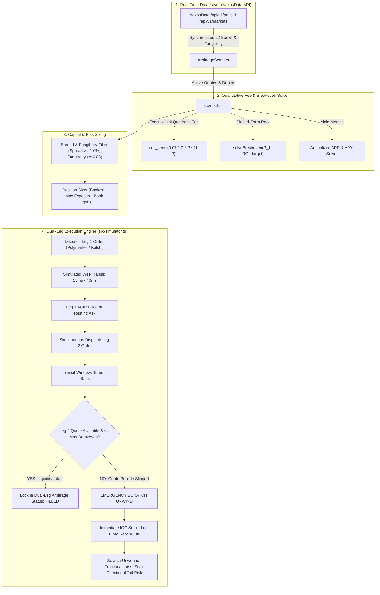
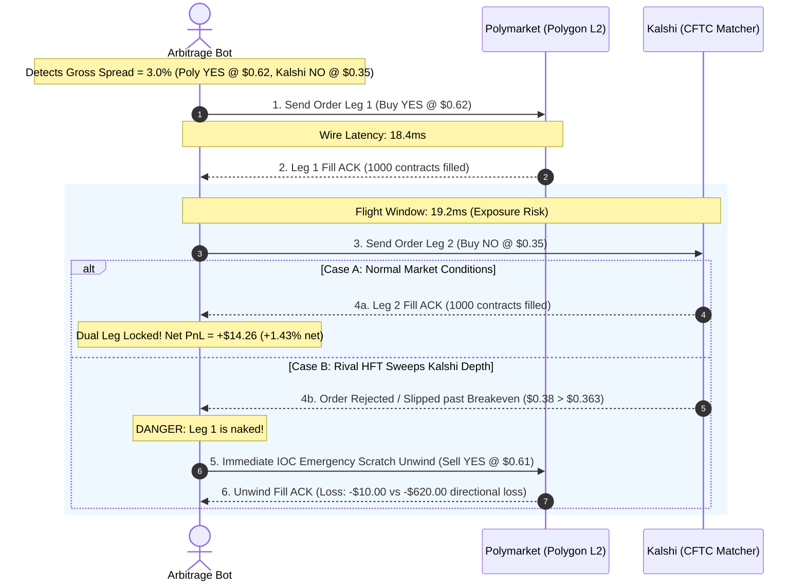

# Polymarket & Kalshi Arbitrage Bot (`polymarket-kalshi-arbitrage-bot`)

[](https://opensource.org/licenses/MIT)
[](https://www.typescriptlang.org/)
[](https://nodejs.org/)
[](https://naxosdata.com)
[]()

> A high-frequency, production-ready, open-source **Polymarket arbitrage bot** and **Kalshi arbitrage** execution engine engineered for risk-free **dual-leg prediction market arbitrage**. Powered by real-time synchronized order book feeds from **[NaxosData.com](https://naxosdata.com)**.

---

## Executive Summary

Cross-venue prediction market arbitrage between **Polymarket** (Polygon PoS, USDC settlement) and **Kalshi** (CFTC-regulated, USD settlement) is one of the highest Sharpe-ratio market-neutral strategies in quantitative finance. Because binary prediction contracts resolve to either \$1.00 or \$0.00:

$$\text{Guaranteed Payout} = \text{Payout}(\text{YES}) + \text{Payout}(\text{NO}) \equiv \$1.00$$

When the combined ask prices across venues are lower than \$1.00:

$$\text{Gross Spread} = \$1.00 - (P_{\text{Polymarket, YES}} + P_{\text{Kalshi, NO}}) > 0$$

However, naive arbitrage bots fail in production because they ignore:
1. **Kalshi's Quadratic Taker Fee**: Unlike linear crypto exchanges, Kalshi charges a non-linear fee curve $\lceil 0.07 \cdot C \cdot P \cdot (1 - P) \rceil$ that peaks at $P = 0.50$.
2. **Wire Flight Latency & Quote Slippage**: Fills are never simultaneous. During the $15\text{ms} - 40\text{ms}$ transit window between Leg 1 fill and Leg 2 match, rival HFT market makers can lift Leg 2.
3. **Unhedged Tail Risk**: Failing on Leg 2 leaves a naked directional exposure with $50\% - 90\%$ downside risk.

**`polymarket-kalshi-arbitrage-bot`** is built from the ground up with institutional quantitative risk controls: closed-form quadratic fee breakeven solvers, synthetic latency models ($15\text{ms}-40\text{ms}$), depth consumption tracking, and an **Emergency Scratch Unwind Safeguard**.

---

## Architecture Overview



---

## Microstructure Execution Timeline

The critical vulnerability in cross-venue dual-leg prediction market arbitrage is the **execution transit window**:



---

## Mathematical Formulation

### 1. Kalshi Quadratic Taker Fee
Kalshi assesses taker transaction fees according to the following official schedule:

$$\text{Fee}(C, P) = \left\lceil 0.07 \times C \times P \times (1 - P) \times 100 \right\rceil \div 100$$

Where:
- $C$: Number of contracts ($C \ge 1$).
- $P$: Contract price in dollars ($0.01 \le P \le 0.99$).
- $\lceil \dots \rceil$: Ceiling function rounding up to the next whole cent (\$0.01).

Fee characteristics:
- **Maximum fee**: At $P = 0.50$, the fee per contract is $\$0.0175$ ($1.75\text{¢}$).
- **Parity symmetry**: $\text{Fee}(C, P) \equiv \text{Fee}(C, 1 - P)$.
- **Tails**: At $P = 0.10$ or $P = 0.90$, the fee per contract is only $\$0.0063$ ($0.63\text{¢}$).

### 2. Dual-Leg Breakeven Solver
Given a primary leg execution price $P_1$, primary fee $\text{fee}_1$, and a target minimum return $r \ge 0$:

$$\text{Total Cost} = P_1 + \text{fee}_1 + P_2 + \text{fee}_2(P_2) \le \frac{1.00}{1 + r / 100}$$

Let $K = \frac{1.00}{1 + r / 100} - P_1 - \text{fee}_1$. Substituting Kalshi's continuous quadratic fee:

$$P_2 + 0.07 P_2 (1 - P_2) \le K \implies 0.07 P_2^2 - 1.07 P_2 + K \ge 0$$

Solving for the maximum counterpart leg price $P_{2, \max}$:

$$P_{2, \max} = \frac{1.07 - \sqrt{1.1449 - 0.28 K}}{0.14}$$

The bot's solver (`solveBreakeven` in `src/math.ts`) derives the analytic root and validates it against discrete cent-by-cent rounding to guarantee zero budget violations.

### 3. Annualized Yield (APR & APY)
For an arbitrage trade expiring in $D$ days with net percentage return $\text{ROI}$:

$$\text{APR} = \text{ROI} \times \left(\frac{365}{\max(D, 1/24)}\right)$$

$$\text{APY} = \left(\left(1 + \frac{\text{ROI}}{100}\right)^{\frac{365}{\max(D, 1/24)}} - 1\right) \times 100$$

A 1.5% net spread on an event resolving in 14 days delivers an annualized APY of **+47.4%**.

---

## Features

- **Real-Time Cross-Venue Scanner (`src/scanner.ts`)**: Connects to the **NaxosData API** (`/api/v1/pairs` & `/api/v1/markets`) to stream synchronized pairs, cross-venue order books, and fungibility scores.
- **Exact CFTC Quadratic Fee Engine (`src/math.ts`)**: Models Kalshi whole-cent rounding and Polymarket Polygon PoS gas costs ($0.008 USD).
- **Closed-Form Breakeven Solver**: Calculates the exact tick threshold for Leg 2 before slippage destroys profitability.
- **Microstructure Execution Simulator (`src/simulator.ts`)**: Models synthetic network latency ($15\text{ms}-40\text{ms}$), order queue priority, book depletion, and adverse quote revisions.
- **Emergency Scratch Unwind Safeguard**: Protects against one-legged executions by instantly unwinding Leg 1 via IOC sell if Leg 2 fails.
- **Rich Terminal CLI (`src/cli.ts`)**: Colorful ANSI dashboard with real-time portfolio metrics, win rate, latency benchmarks, and profit tracking.
- **Zero Heavy Dependencies**: Pure TypeScript, native `fetch`, native `AbortSignal`, native Node.js test runner (`node:test`).

---

## Quickstart

### Prerequisites
- **Node.js**: `v18.0.0` or higher (Node 20+ or 24+ recommended)
- **npm**: `v9.0.0` or higher

### Installation

```bash
# Clone the repository
git clone https://github.com/nexosdata/polymarket-kalshi-arbitrage-bot.git
cd polymarket-kalshi-arbitrage-bot

# Install dev dependencies (TypeScript & @types/node)
npm install

# Compile TypeScript
npm run build
```

### Running Tests

Run the automated test suite powered by Node's native test runner:

```bash
npm test
```

Expected output:
```text
✔ Fee Math: ceilCents rounds up to whole cent without floating point glitches (0.3ms)
✔ Fee Math: calculateKalshiTakerFee exact exchange quadratic formula (0.1ms)
✔ Fee Math: calculatePolymarketFee calculates L2 gas and taker fee (0.1ms)
✔ Breakeven Solver: solveBreakeven solves maximum counterpart price within budget (0.1ms)
✔ Return Math: calculateArbitrageReturn metrics, APR, and APY (0.1ms)
✔ Scanner: generateMockPairs produces realistic synchronized pairs (0.7ms)
✔ Scanner: scanOpportunities filters by spread, fungibility, and depth (0.4ms)
✔ Scanner: custom fetch mock connects and parses API correctly (9.1ms)
✔ Simulator: executes dual-leg order with latency and updates bankroll (0.3ms)
✔ Simulator: triggers emergency scratch unwind when Leg 2 liquidity is pulled (0.2ms)
✔ Simulator: triggers scratch unwind when Leg 2 slips beyond max breakeven price (0.2ms)
✔ Simulator: rejects execution when bankroll is exhausted (0.1ms)
✔ CLI: parseArgs correctly parses flags and applies defaults (0.1ms)
ℹ tests 13
ℹ suites 0
ℹ pass 13
ℹ fail 0
```

---

## CLI Usage

### Interactive Paper Simulation (Dry Run)

Run the bot out of the box in simulation mode (offline synthetic feed active if no API key is supplied):

```bash
npm start
# or
node dist/cli.js --dry-run --bankroll 10000 --min-spread 1.2
```

### Run for Fixed Iterations (Testing / CI)

```bash
node dist/cli.js --iterations 3 --min-spread 1.0
```

### Connect to Live NaxosData API

```bash
export NAXOS_API_KEY="nx_live_your_api_key_here"
node dist/cli.js --bankroll 25000 --max-exposure-per-arb 5000 --min-fungibility 0.90
```

---

## CLI Options Reference

| Flag | Type | Default | Description |
| :--- | :--- | :--- | :--- |
| `--min-spread <pct>` | `number` | `1.0` | Minimum gross spread percentage threshold to consider a trade. |
| `--min-fungibility <score>` | `number` | `0.85` | Minimum resolution criteria similarity score ($0.0 - 1.0$). |
| `--target-roi <pct>` | `number` | `0.5` | Minimum net ROI percentage required after all exchange fees. |
| `--bankroll <usd>` | `number` | `5000` | Starting bankroll balance in USD. |
| `--max-exposure-per-arb <usd>` | `number` | `1000` | Maximum capital allocated to any single arbitrage pair. |
| `--poll-interval-ms <ms>` | `number` | `2000` | Polling frequency in milliseconds between scanner cycles. |
| `--latency-min-ms <ms>` | `number` | `15` | Minimum simulated wire delay in milliseconds. |
| `--latency-max-ms <ms>` | `number` | `40` | Maximum simulated wire delay in milliseconds. |
| `--dry-run` | `boolean` | `true` | Runs paper simulation mode with portfolio tracking. |
| `--live` | `boolean` | `false` | Enables live execution mode against exchange endpoints. |
| `--api-key <key>` | `string` | `process.env.NAXOS_API_KEY` | NaxosData API authentication key. |
| `--iterations <num>` | `number` | `undefined` | Terminates after $N$ iterations (useful for CI / automated tests). |
| `--help`, `-h` | `flag` | - | Displays help and flag reference. |

---

## Programmatic Library Usage

You can import the core modules directly into your existing quantitative trading systems:

```typescript
import {
  ArbitrageScanner,
  ArbitrageSimulator,
  solveBreakeven,
  calculateKalshiTakerFee,
  calculateArbitrageReturn,
} from 'polymarket-kalshi-arbitrage-bot';

// 1. Calculate Kalshi quadratic taker fee
const fee = calculateKalshiTakerFee(500, 0.45);
console.log(`Kalshi fee for 500 contracts @ $0.45: $${fee.toFixed(2)}`);

// 2. Solve counterpart breakeven price
const be = solveBreakeven({
  primaryPrice: 0.62,   // Polymarket YES ask
  targetRoiPct: 1.5,     // Target 1.5% net ROI
  contracts: 1000,
});
console.log(`Max Kalshi NO price: $${be.maxCounterpartPrice}`);

// 3. Scan real-time opportunities
const scanner = new ArbitrageScanner({
  apiKey: process.env.NAXOS_API_KEY,
});

const opportunities = await scanner.scanOpportunities({
  minSpreadPct: 1.5,
  minFungibility: 0.90,
});

// 4. Execute through the simulator
const simulator = new ArbitrageSimulator({ bankrollUsd: 10000 });
for (const opp of opportunities) {
  const result = await simulator.execute(opp);
  console.log(`Executed: ${result.status} | Net PnL: $${result.realizedPnlUsd}`);
}
```

---

## Powered by NaxosData API

[NaxosData.com](https://naxosdata.com) is the premier low-latency market microstructure data feed and Level 2 historical archive for prediction markets.

### Why NaxosData for Cross-Venue Arbitrage?
- **Fungibility & Settlement Mapping (`/api/v1/pairs`)**: Standard market data APIs do not map identical contracts. NaxosData pairs Polymarket condition IDs with Kalshi market tickers using semantic NLP and contractual verification scores (`fungibility_score`).
- **Synchronized Order Books (`/api/v1/markets`)**: Reconstructed canonical order books accounting for reciprocal binary odds ($P_{\text{YES}} = 1.0 - P_{\text{NO}}$).
- **Low Latency & WebSockets**: Sub-millisecond tick streaming with colocation options.

To obtain an API key:
1. Register at [https://naxosdata.com](https://naxosdata.com).
2. Generate an API token (`nx_live_...`).
3. Set the environment variable:
   ```bash
   export NAXOS_API_KEY="nx_live_..."
   ```

---

## Repository Structure

```text
polymarket-kalshi-arbitrage-bot/
├── LICENSE                 # MIT License (2026 NaxosData Contributors & William Gonda)
├── README.md                # Quantitative documentation, diagrams & guides
├── .gitignore               # Git ignore rules
├── package.json             # NPM package specification & binary exports
├── tsconfig.json            # Strict TypeScript configuration (NodeNext)
├── src/
│   ├── types.ts             # Strongly typed market, pair, and order interfaces
│   ├── math.ts              # Kalshi quadratic taker fee, breakeven solver, APR/APY
│   ├── scanner.ts           # NaxosData API client, market pairing, spread filters
│   ├── simulator.ts         # Dual-leg execution engine, 15-40ms latency, scratch unwinds
│   ├── cli.ts               # Terminal CLI runner with ANSI dashboard & flags
│   └── index.ts             # Public module export entrypoint
├── test/
│   └── arbitrage.test.mjs   # Native Node test suite (13/13 passing)
└── examples/
    └── quickstart.mjs       # Programmatic usage walkthrough
```

---

## Risk Disclaimer

> Prediction market trading involves capital risk. While dual-leg cross-venue arbitrage is theoretically risk-free upon simultaneous execution, real-world execution entails exchange counterparty risk, physical latency transit slippage, smart contract gas volatility, and settlement ambiguity. Always test strategies thoroughly in `--dry-run` simulation before deploying real capital.

---

## License

This project is licensed under the **MIT License** — see the [LICENSE](LICENSE) file for details.

Copyright (c) 2026 NaxosData Contributors & William Gonda.
